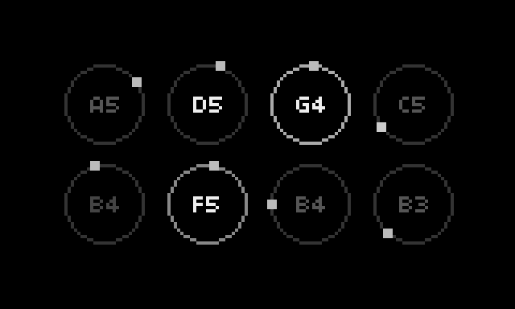

# loops

phasing loops for norns, after Brian Eno's *Music for Airports*.



up to eight loops, each playing a note from one scale whenever it comes round, each at its own speed. the lengths don't line up, so the loops meet in ever new combinations: always consonant, never repeating. every loop slowly fades out over its lifespan and is reborn with a new note, speed and character. played on a sampled Rhodes with a slow stereo vibrato, a long reverb and a tape delay that wears with every repeat.

the idea comes from Eno's tape loops (each of a different length, each carrying one note) and Steve Reich's phasing.

## requirements

- norns (made on a Raspberry Pi 4, norns 2.9.4)
- the jRhodes3d samples (see install), about 22 MB

## documentation

each circle is a loop. a dot goes round at the loop's speed, and the note plays when it's back at the top; the circle lights up, with the note's name inside. as a loop fades out, its circle gets darker; reborn, it's back at full brightness with its new note.

| control | action |
|---|---|
| K2 | reset: a new set of loops |
| K3 | start / stop |
| E1 | lifespan: how many passes the loops last, from 1-10 up to 20-30 |
| E2 | voices: how many loops play, 1-8 |
| E3 | variety: how different the loops are |

**variety** at 0: all notes ring out, the loops run 15-35 s each and all last about as long. turning it up gives each loop its own note length (short to long), its own speed (from a few seconds to over a minute) and its own lifespan.

each loop's level and speed also drift slowly, and the whole piece breathes over a few minutes, so it keeps moving even when you leave it alone.

### params

PARAMS > loops has what the controls don't set:

- **key**, **scale** (the modes ionian, dorian, lydian; the five-note scales major pentatonic (default), minor pentatonic, hirajoshi, kumoi and airports (the notes of Eno's *Music for Airports 2/1*: with key F the original pitches); melodic minor, harmonic minor, whole tone): a change makes a new set of loops
- **vibrato**, **vibrato rate**: the Rhodes' stereo tremolo (default 50 %, 2.5 Hz)
- **tape**, **tape time**, **tape feedback**, **tape wear**: the tape delay. every repeat goes through the same tape faults again (lost highs and lows, saturation, wow and flutter, dropouts, hiss), so the echoes wear more with each pass. turn up `tape feedback` and `tape wear` to hear them dissolve

## install

```
;install https://github.com/loopmasta/loops
```

or copy `loops.lua`, `lib/` and `select.png` to `dust/code/loops/`.

then the samples: loops plays the **jRhodes3d** set by Jeff Learman (a 1977 Rhodes Mark I Stage 73). its samples are free to make music with (CC0), but their license (CC BY-NC 4.0) doesn't let them be bundled here, so fetch the mono set from its own repository once, over ssh on the norns:

```
mkdir -p ~/dust/audio/loops && cd /tmp
git clone --depth 1 --filter=blob:none --sparse https://github.com/sfzinstruments/jlearman.jRhodes3d jrhodes
cd jrhodes && git sparse-checkout set jRhodes3d-mono
mv jRhodes3d-mono ~/dust/audio/loops/
mv LICENSE ~/dust/audio/loops/LICENSE-jRhodes3d.txt
mv README.md ~/dust/audio/loops/README-jRhodes3d.md
cd /tmp && rm -rf jrhodes
```

the samples end up in `dust/audio/loops/jRhodes3d-mono/`. loops brings its own SuperCollider engine (`lib/Engine_Loops.sc`): after installing, **restart norns once** (SYSTEM > RESTART), so SuperCollider picks it up.

`select.png` is a background for the SELECT preview. stock norns doesn't show it: it needs a small patch to norns' preview menu (see [shieldxl-trixie](https://github.com/loopmasta/shieldxl-trixie)), so it's optional.

## credits

- samples: [jRhodes3d](https://github.com/sfzinstruments/jlearman.jRhodes3d) by Jeff Learman. samples CC BY-NC 4.0, music made with them CC0
- after Brian Eno's *Music for Airports* and Steve Reich's phasing pieces
